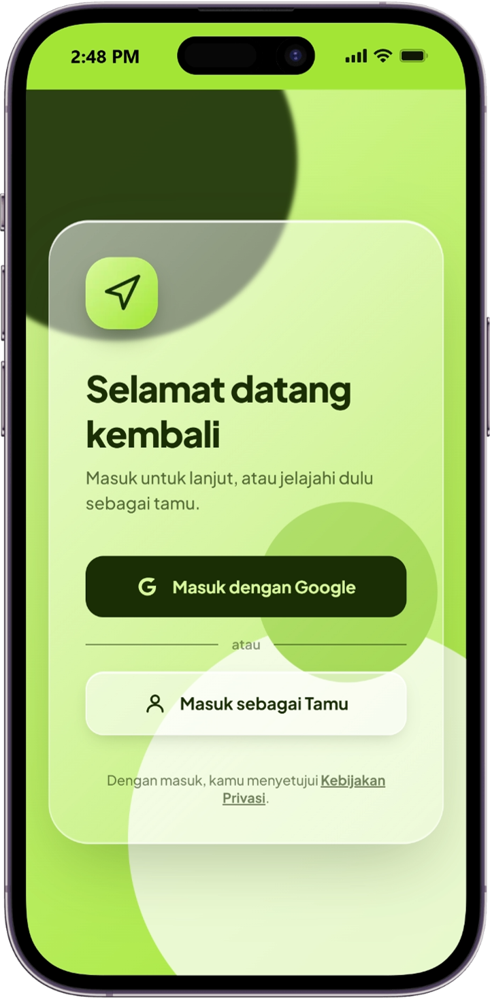
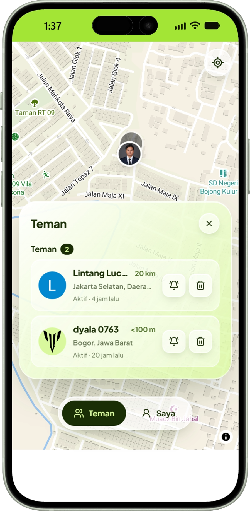
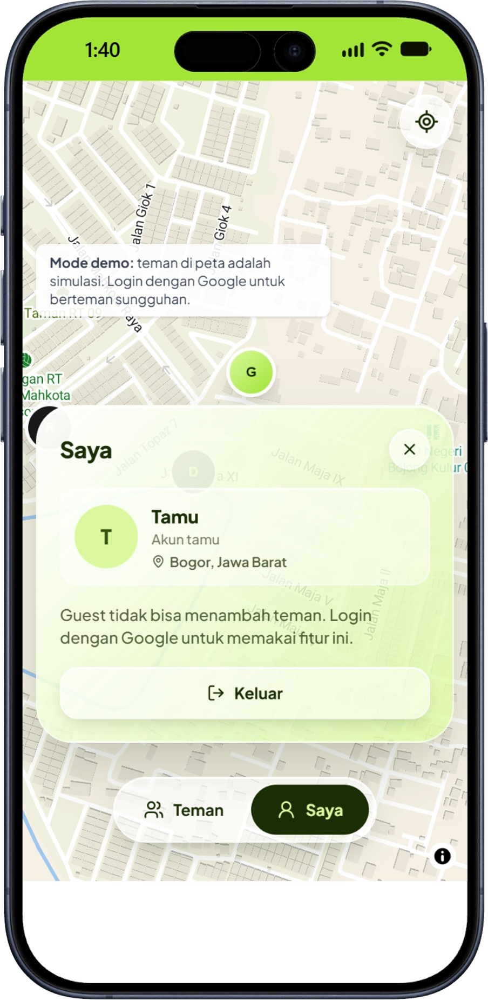
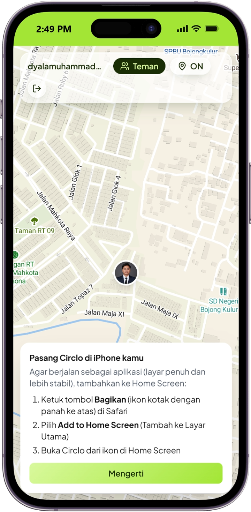

# Circlo

Berbagi lokasi realtime dengan teman, terinspirasi dari Find My dan Zenly. Web app berbasis PWA yang bisa langsung dicoba tanpa daftar.

**Demo:** https://circlo-rouge.vercel.app
**Coba cepat:** klik **Masuk sebagai Tamu**, izinkan lokasi, lalu lihat teman simulasi bergerak di peta.

## Screenshots

|                Login                 |              Panel Teman               |
| :----------------------------------: | :------------------------------------: |
|  |  |

|          Mode Demo (Tamu)          |              Banner iPhone              |
| :--------------------------------: | :-------------------------------------: |
|  |  |

## Fitur

- Login dengan Google, atau **mode Tamu** (anonymous) untuk mencoba tanpa daftar
- Peta interaktif dengan marker avatar, lokasi sendiri, dan tombol relocate
- Pertemanan lewat **kode invite**: kirim permintaan, terima atau tolak, hapus teman
- Lokasi teman bergerak **realtime**, dengan status "terakhir dilihat" (marker memudar setelah 2 menit tanpa update)
- Toggle **bagikan lokasi ON/OFF**
- Klik **Lihat** pada teman untuk terbang ke lokasinya
- **PWA**: bisa dipasang ke Home Screen, dengan banner petunjuk khusus Safari iPhone
- **Mode demo** untuk tamu: tiga teman simulasi bergerak di sekitar posisimu
- Tampilan glass dengan tema lime
- **Notifikasi push** (opsional): ping dari teman ("kamu di mana?") dan pengingat rutin untuk membuka Circlo
- Banner ajakan aktifkan notifikasi, plus tombol lonceng di bar atas
- Nama area lokasi teman (reverse geocoding MapTiler) dan kartu teman yang bisa diklik untuk terbang ke lokasinya

## Tech stack

| Bagian     | Teknologi                                                            |
| ---------- | -------------------------------------------------------------------- |
| Frontend   | Next.js (App Router), React, TypeScript, Tailwind CSS                |
| Peta       | MapLibre GL JS + tile MapTiler                                       |
| Backend    | Supabase: Auth, PostgreSQL, Realtime (WebSocket), Row Level Security |
| PWA        | Web App Manifest + service worker minimal                            |
| Deploy     | Vercel                                                               |
| Ikon       | lucide-react                                                         |
| Notifikasi | Web Push API (VAPID) dengan library `web-push`                       |
| Penjadwal  | Upstash QStash (cron untuk pengingat rutin)                          |

## Arsitektur

Alur singkat:

1. Browser membaca posisi lewat Geolocation API (`watchPosition`).
2. Posisi dikirim dengan **throttle**: minimal tiap 5 detik jika bergeser lebih dari 10 m, atau heartbeat tiap 30 detik.
3. Hanya **posisi terbaru** per user yang disimpan (upsert), bukan riwayat.
4. Teman menerima perubahan lewat Supabase Realtime dan marker bergerak otomatis.

Alur notifikasi:

1. User mengaktifkan notifikasi, browser membuat langganan push yang disimpan di `circle_push_subscriptions`.
2. **Ping teman:** API route memanggil fungsi SQL yang memvalidasi pertemanan dan batas frekuensi, lalu server mengirim push.
3. **Pengingat rutin:** QStash memanggil `/api/cron/reminder` sesuai jadwal (08.00 dan 18.00 WIB). Request diverifikasi lewat signature, lalu server mengirim push hanya ke user yang lokasinya sudah lama tidak diperbarui dan sharing-nya aktif.
4. Mengetuk notifikasi membuka Circlo, sehingga lokasi langsung diperbarui.

### Keputusan teknis

- **Supabase Realtime sebagai WebSocket**, jadi tidak perlu server sendiri untuk di-host.
- **MapLibre + MapTiler** dipilih agar gratis tanpa kartu kredit, tampilan vector modern, dan tanpa risiko tagihan.
- **Keamanan di level database (RLS)**, bukan hanya di UI. Lokasi hanya bisa dibaca oleh pemiliknya dan teman berstatus _accepted_.
- **Tambah teman hanya lewat fungsi SQL** `circle_add_friend_by_code`, yang menolak akun tamu. Tabel pertemanan tidak punya izin insert langsung.
- **Mode demo berjalan di browser**, tanpa menulis data palsu ke database.
- **Prefix `circle_`** pada semua tabel, fungsi, dan policy karena project Supabase dipakai bersama aplikasi lain.
- **Web Push langsung dengan VAPID**, tanpa Firebase, agar tidak menambah ketergantungan layanan.
- **Satu jadwal QStash untuk semua user.** Endpoint yang memilih target dan mengirim, jadi pemakaian pesan QStash sangat kecil dan aman di free tier.
- **Pengingat yang tidak mengganggu:** dilewati untuk user yang lokasinya masih baru atau sharing-nya mati, dan tidak dikirim di malam hari.
- **Anti-spam ping:** hanya teman _accepted_, tamu ditolak, maksimal satu ping per pasangan setiap 15 menit, divalidasi di fungsi SQL.

### Skema database

| Tabel                       | Fungsi                                                |
| --------------------------- | ----------------------------------------------------- |
| `circle_profiles`           | Nama, avatar, status tamu, kode invite                |
| `circle_friendships`        | Relasi teman (`pending` / `accepted`)                 |
| `circle_locations`          | Posisi terbaru, akurasi, status sharing, waktu update |
| `circle_push_subscriptions` | Langganan notifikasi per perangkat                    |
| `circle_pings`              | Catatan ping, dipakai untuk pembatasan frekuensi      |

Skrip SQL ada di `supabase/sql/` dan dijalankan berurutan.

## Batasan yang perlu diketahui

**Lokasi dan background**

- Web app **tidak bisa melacak di background**. Lokasi hanya diperbarui saat Circlo **tampil di layar**. Saat tab atau PWA ditutup, dipindah ke app lain, atau layar terkunci, pengiriman berhenti. Teman melihatmu sebagai "terakhir dilihat".
- Kalau perangkat diam, callback `watchPosition` bisa jarang terpanggil, sehingga heartbeat 30 detik tidak selalu terjadi dan marker bisa terlihat memudar walau app terbuka.
- Marker teman bisa butuh hingga sekitar 30 detik untuk muncul setelah pertemanan diterima atau sharing dinyalakan kembali.
- Hanya posisi terakhir yang disimpan, tidak ada riwayat rute.

**Login dan perangkat**

- Di iPhone, PWA di Home Screen punya penyimpanan terpisah dari Safari. Saat **login Google pertama kali di PWA**, daftar akun tersimpan tidak muncul dan akun perlu diketik. Setelah login, sesi tetap tersimpan.
- Akun **Tamu tidak bisa berteman** dan tidak bisa dicari oleh teman. Tamu hanya melihat teman simulasi.
- Teman di mode demo adalah **simulasi**, bukan pengguna sungguhan.
- Penghapusan akun masih manual lewat email (lihat halaman Kebijakan Privasi).

**Infrastruktur gratis**

- **Supabase Free** otomatis di-_pause_ setelah 7 hari tanpa aktivitas dan harus direstore dari dashboard. Project ini berbagi database dengan aplikasi lain, sehingga ada risiko bentrok pengaturan Auth.
- **MapTiler Free** punya kuota bulanan dan hanya untuk penggunaan non-komersial. Key dibatasi ke domain demo, sehingga peta tidak tampil di domain lain.
- **Vercel Hobby** hanya untuk penggunaan personal non-komersial.
- Batas gratis dapat berubah, cek halaman harga masing-masing penyedia.

**Notifikasi**

- Notifikasi **tidak memperbarui lokasi dengan sendirinya**. Ia hanya mengingatkan, dan lokasi baru terkirim setelah Circlo dibuka.
- Di **iPhone**, notifikasi hanya bekerja jika Circlo **dipasang ke Home Screen** (iOS 16.4 ke atas), dan izin harus diminta lewat tombol.
- Notifikasi hanya untuk akun Google. Tamu tidak bisa menerima maupun mengirim ping.
- Teman harus sudah mengaktifkan notifikasi untuk bisa menerima ping.
- Pengiriman bergantung pada layanan push milik browser (Google, Apple, Mozilla), sehingga waktu tiba bisa tertunda dan tidak dijamin.

## Menjalankan secara lokal

**Prasyarat:** Node.js, akun Supabase, dan API key MapTiler.

```bash
git clone https://github.com/USERNAME_KAMU/circlo.git
cd circlo
npm install
```

Buat `.env.local` di root project:

```env
NEXT_PUBLIC_SUPABASE_URL=...
NEXT_PUBLIC_SUPABASE_PUBLISHABLE_KEY=sb_publishable_...
NEXT_PUBLIC_MAPTILER_KEY=...

# Notifikasi (opsional untuk pengembangan lokal)
NEXT_PUBLIC_VAPID_PUBLIC_KEY=...
VAPID_PRIVATE_KEY=...
VAPID_SUBJECT=mailto:emailkamu@example.com
SUPABASE_SECRET_KEY=sb_secret_...
QSTASH_CURRENT_SIGNING_KEY=...
QSTASH_NEXT_SIGNING_KEY=...
REMINDER_STALE_HOURS=6
```

Setup Supabase:

1. Jalankan skrip di `supabase/sql/` secara berurutan lewat SQL Editor.
2. Aktifkan **Google** di _Authentication → Providers_ dan **Allow anonymous sign-ins**.
3. Tambahkan `http://localhost:3000/**` dan URL deploy ke _Redirect URLs_.
4. Pastikan tabel `circle_locations` dan `circle_friendships` ada di publikasi `supabase_realtime`.

Jalankan:

```bash
npm run dev
```

Untuk mencoba PWA dan service worker (aktif hanya di production):

```bash
npm run build && npm start
```

**Catatan MapLibre:** worker peta disajikan dari `public/maplibre/` (`maplibre-gl-worker.mjs` dan `maplibre-gl-shared.mjs`) karena Turbopack tidak menyertakannya otomatis. Jika versi `maplibre-gl` di-upgrade, salin ulang kedua file itu dari `node_modules/maplibre-gl/dist/`.

## Privasi

Lokasi hanya terlihat oleh teman yang sudah diterima, dan kamu bisa mematikan pembagian kapan saja. Detail lengkap ada di halaman `/privacy`.

---

Dibuat oleh **Dyala Muhammad Panahpertama** · [LinkedIn](https://linkedin.com/in/dyalamuhammad) · [GitHub](https://github.com/dyalamuhammad)
